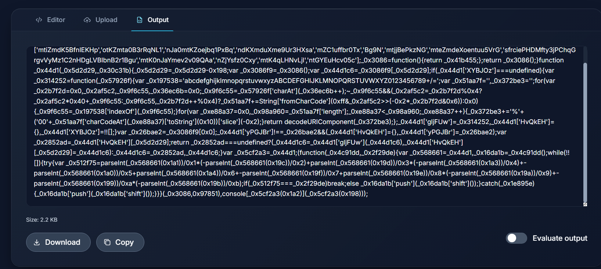

# JavaScript Deobfuscation

## Packing JavaScript code

`packer` turns all words into a list of dictionary and then uses `function(p,a,c,k,e,d)` to rebuild the original code to execute, a tool we can refer is https://beautifytools.com/javascript-obfuscator.php. Although this technique makes code harder to read, it still reveals some important strings in cleartext. Therefore, we need a more complicated obsfucation technique.

## More advanced tools

- https://obfuscator.io/legacy-playground
  

- This type of obfuscation includes many techniques: String Array, Decoding, Identifier Renaming, Control Flow Obfuscation

## Deobfuscation

Using such useful tools:

- https://matthewfl.com/unPacker.html
- https://obf-io.deobfuscate.io
